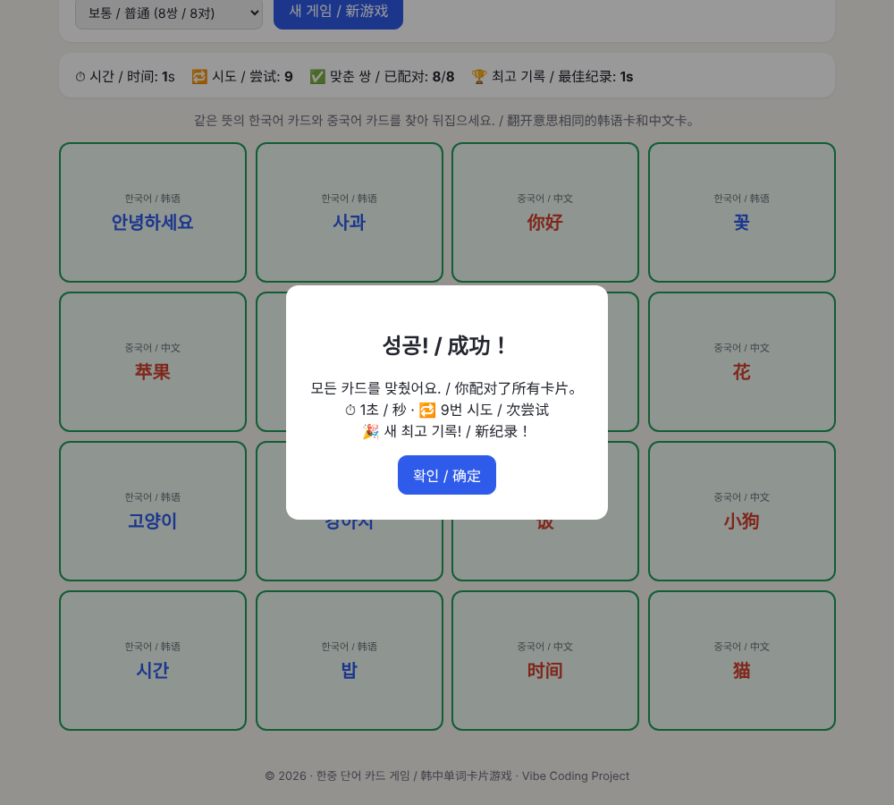

# 한중 단어 카드 게임 / 韩中单词卡片游戏

> AI 바이브 코딩으로 만든 한국어·중국어 단어 학습 웹 게임
> 使用 AI 氛围编程制作的韩语·中文单词学习网页游戏

## 📌 목적 / 目的

- **한국어:** 한국어와 중국어를 공부하는 학생이 카드 게임과 퀴즈로 기초 단어를 재미있게 외울 수 있도록 돕습니다.
- **中文：** 帮助学习韩语和中文的学生，通过卡片游戏和测验轻松有趣地记住基础单词。

## ✨ 주요 기능 / 主要功能

| 기능 / 功能 | 설명 (한국어) | 说明（中文） |
|---|---|---|
| 🃏 카드 짝 맞추기 / 翻牌配对 | 같은 뜻의 한국어 카드와 중국어 카드를 찾아 짝을 맞춥니다. 난이도 3단계, 시간·시도 횟수·최고 기록 표시 | 找出意思相同的韩语卡和中文卡进行配对。3 个难度，显示时间、尝试次数和最佳纪录 |
| 📝 단어 퀴즈 / 单词测验 | 10문제 4지선다 퀴즈. 한→중, 중→한 방향 선택, 정답/오답 피드백, 틀린 단어 복습 | 10 道四选一测验。可选择韩→中或中→韩，即时显示对错，并复习答错的单词 |
| 📖 단어장 / 单词表 | 전체 단어 목록(한국어·중국어·병음)과 검색 기능 | 全部单词列表（韩语·中文·拼音）及搜索功能 |

- 화면의 모든 제목, 메뉴, 버튼, 안내 문구, 결과·오류 메시지는 **한국어 / 中文** 병기
- 界面上所有标题、菜单、按钮、提示、结果和错误信息均为 **韩语 / 中文** 双语

## 🚀 실행 방법 / 运行方法

별도 설치가 필요 없습니다. / 无需安装任何程序。

1. 이 저장소를 내려받습니다. / 下载本仓库：
   ```bash
   git clone https://github.com/YOUR-ID/kc-word-game.git
   ```
2. 폴더 안의 `index.html` 파일을 브라우저(Chrome, Edge 등)로 엽니다.
   用浏览器（Chrome、Edge 等）打开文件夹中的 `index.html`。
3. 상단 탭에서 원하는 모드를 선택해 플레이합니다.
   在顶部标签中选择想玩的模式即可开始。

## 📁 파일 구성 / 文件结构

```
kc-word-game/
├── index.html   # 화면 구조 / 页面结构
├── style.css    # 디자인 / 样式
├── script.js    # 게임 로직 / 游戏逻辑
├── words.js     # 단어 데이터 / 单词数据（可自行添加单词）
└── README.md
```

단어를 추가하려면 `words.js`에 `{ ko: "...", zh: "...", py: "..." }` 형식으로 넣으면 됩니다.
如需添加单词，在 `words.js` 中按 `{ ko: "...", zh: "...", py: "..." }` 格式添加即可。

## 🖼 실행 화면 / 运行截图

<!-- 스크린샷을 screenshots 폴더에 넣고 아래 경로를 수정하세요 / 把截图放进 screenshots 文件夹并修改下面的路径 -->


## 🛠 사용 기술 / 使用技术

HTML · CSS · JavaScript (프레임워크 없음 / 无框架) · WebStorm (IDE / 통합 개발 환경)
